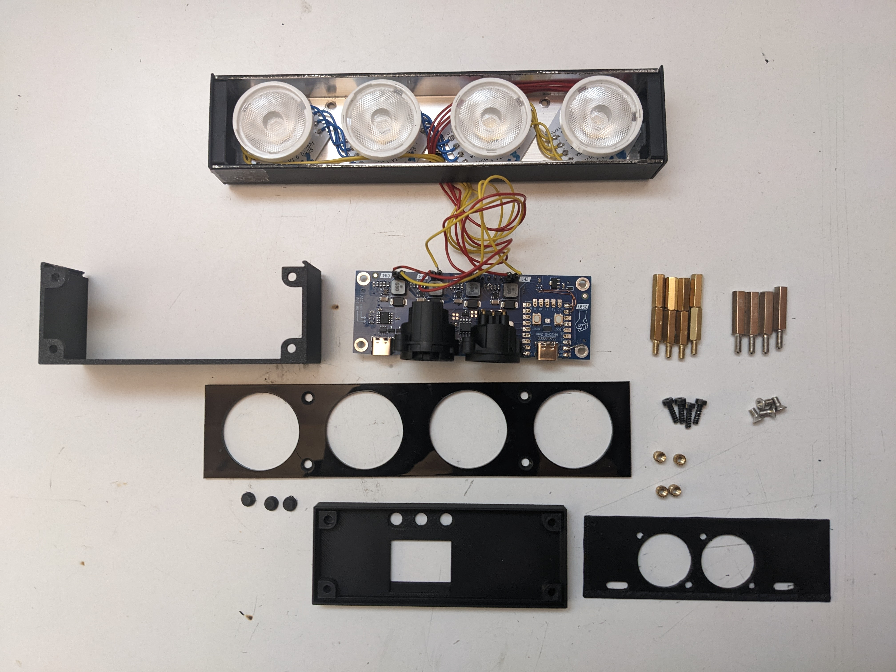
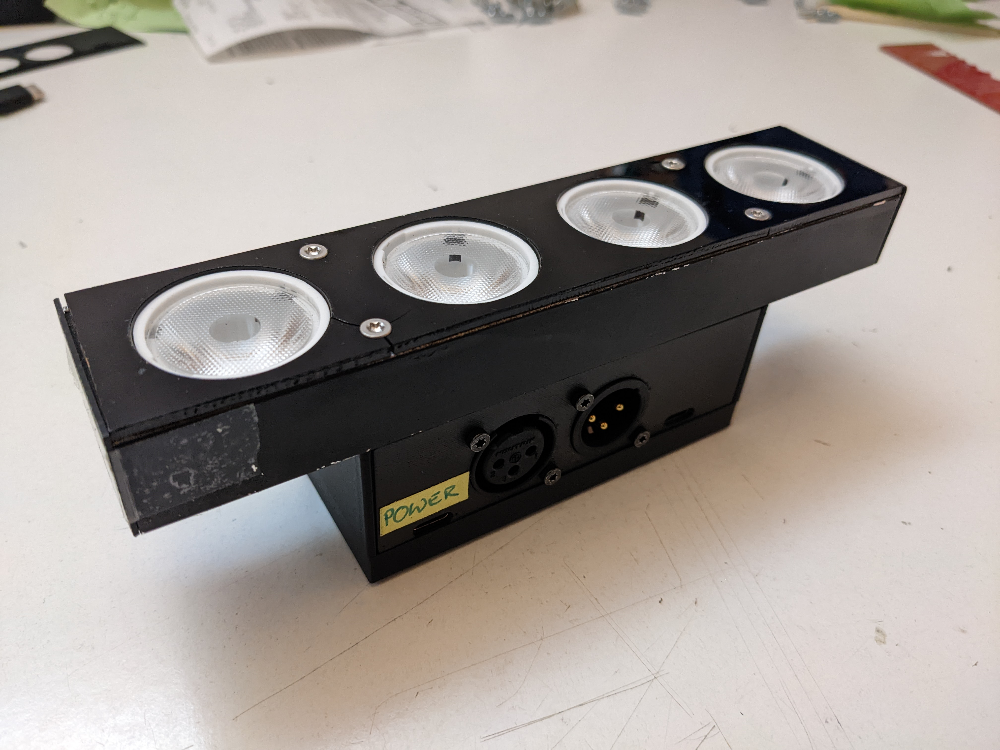

## Screws and Bolts
4x Standoff M3 x 28mm
(4x Standoff M3 x 18mm)
4x (8x) M3 x 6mm countersunk head
4x Self taping scew for XLR

## 3D printed parts
Enclosure_bottom_V6.step
Enclosure_face_V3.step
Enclosure_Back_V3.step
Enclosure_buttoncap_V3.step

Use your favorite filament. No support structure needed.

 
## LED housing
I used 40mm Aluminium U-Profile and custom LED PCB. You can take whatever LED you like. Just make shure they can handle the current. 
The lenses come from Aliexpress.
The LED face ist laser cut from PMMA. You can also 3D print it.
## Assembly
1. Fasten the face part to the PCB with the four self taping screws
2. Place three button caps in the bottom shell
3. Place the PCB in the bottom enclosure part
4. Screw in the four M3x28mm Standoffs to fasten the PCB
	1. Tighten it carefully! It must not wear out the printed part!
	2. You could also drill the hole to a size that fits heat inserts
5. Slide over the back enclosure part
6. Fasten your custom LED housing to the back enclosure part with the 18mm standoffs 
7. Fasten your custom LED face part with M3x6mm screws.

 
